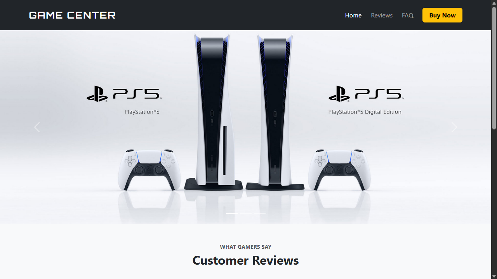
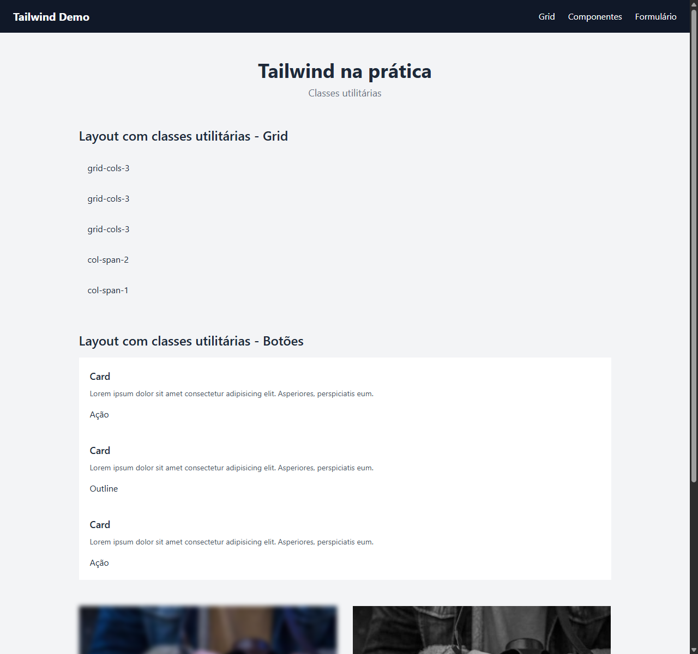

# UI Multiverse 🌌

Laboratório prático de desenvolvimento front-end focado na comparação de diferentes paradigmas, arquiteturas e frameworks de estilização para a web.

O objetivo do repositório é aplicar a mesma base de boas práticas de interface através de abordagens visuais distintas: **componentes estruturados (Bootstrap)**, **utilitários modulares (Tailwind CSS)** e, na sequência, **vibe coding**.

---

## 📁 Estrutura do Repositório

```text
ui-multiverse/
├── assets/
│   └── screenshots/          # Imagens de demonstração dos projetos
├── bootstrap/                # Projeto 1: Implementação com Bootstrap 5
│   ├── Atividade/            # Orientações e layout de referência
│   ├── css/                  # Estilos complementares
│   ├── index.html            # Interface Game Center
│   └── README.md
├── tailwind/                 # Projeto 2: Implementação com Tailwind CSS
│   ├── Atividade/            # Orientações e layout de referência
│   ├── index.html            # Interface Tailwind na Prática
│   └── README.md
└── vibecode/                 # Projeto 3: Em desenvolvimento ⏳
```

---

## 🎮 1. Bootstrap 5 — Game Center

Aplicação voltada para o comércio gamer fictício **Game Center**, estruturada com o ecossistema de componentes e o sistema de grid do **Bootstrap 5.3**. O projeto combina elementos prontos do framework com tipografia personalizada e comportamento interativo.

### 📸 Preview do Site Criado


### ✨ Destaques e Componentes Implementados
- **Navbar & Ações:** Barra superior escura com links de navegação suave e botão de ação rápida (*Buy Now*).
- **Modal de Compra:** Janela modal interativa para seleção e confirmação prévia de itens antes do carrinho.
- **Hero Carousel:** Carrossel dinâmico com banners de grandes lançamentos (PlayStation 5, GTA VI e EA Sports FC), com paginação e indicadores interativos.
- **Depoimentos (Reviews):** Carrossel interativo em tema escuro (`carousel-dark`) exibindo avaliações dos clientes, estrelas de classificação e perfil do usuário.
- **FAQ com Accordion:** Seção de perguntas frequentes com abertura e fechamento expansível nativo do Bootstrap.
- **Customização de Estilos:** Tipografia futurista para a marca via Google Fonts (*Orbitron*) e padronização visual dos slides no arquivo `css/style.css`.

### 🛠️ Tecnologias
- **HTML5:** Estrutura semântica.
- **Bootstrap 5.3 (via CDN):** Componentes, sistema de grid e utilitários.
- **CSS3:** Ajustes finos de altura de slides e fontes externas.

---

## 🎨 2. Tailwind CSS — Tailwind na Prática

Interface desenvolvida sob o conceito **utility-first**, explorando a composição de estilos diretamente no markup HTML sem a necessidade de folhas de estilo externas personalizadas.

### 📸 Preview do Site Criado


### ✨ Destaques e Recursos Demonstrados
- **Navbar Utilitária:** Layout flexível com alinhamento responsivo (`flex items-center justify-between`) e estados de foco/hover nos links de navegação (`hover:text-cyan-600`).
- **Sistema de Grid Nativo:** Demonstração prática do CSS Grid aplicado via utilitários (`grid`, `grid-cols-3`, `gap-4`), incluindo mesclagem de colunas (`col-span-2` e `col-span-1`).
- **Cards e Botões Componentizados:** Cards estruturados com cantos arredondados, sombras sutis e variantes de botões (botão de destaque sólido e botão em formato *outline*).
- **Filtros e Transições em Imagens:** Galeria demonstrando o uso de classes de efeitos visuais (`blur-xs`, `grayscale`) com transições suaves ativadas ao passar o mouse (`hover:filter-none transition duration-500`).
- **Animações Nativas:** Demonstração de utilitários de animação (`animate-ping`, `animate-bounce`, `animate-spin`) integrados a ícones vetoriais.

### 🛠️ Tecnologias
- **HTML5:** Estrutura semântica.
- **Tailwind CSS (v4 via Browser Runtime / CDN):** Framework utility-first para estilização rápida.
- **Boxicons:** Biblioteca de ícones vetoriais via CDN.

---

## ⚡ 3. VibeCode — *Em Desenvolvimento*

A terceira implementação deste repositório explorará o fluxo de **Vibe Coding** (desenvolvimento ágil de front-end com assistência e prototipagem inteligente de interface), completando a tríade de paradigmas de estilização.

> ⏳ **Status:** Próxima etapa a ser iniciada e integrada neste repositório.

---

## 💻 Como Executar os Projetos Localmente

Ambos os projetos foram construídos utilizando recursos carregados via CDN, sem a necessidade de instalação de dependências ou build step pesado:

1. Clone o repositório unificado:
   ```bash
   git clone https://github.com/Jottape11/ui-multiverse.git
   ```

2. Para testar o projeto **Bootstrap**:
   - Abra o arquivo `bootstrap/index.html` diretamente em seu navegador web (ou utilize a extensão *Live Server* do VS Code).

3. Para testar o projeto **Tailwind**:
   - Abra o arquivo `tailwind/index.html` em seu navegador web (de preferência via *Live Server* ou servidor local para renderização completa das fontes e scripts utilitários do runtime).

