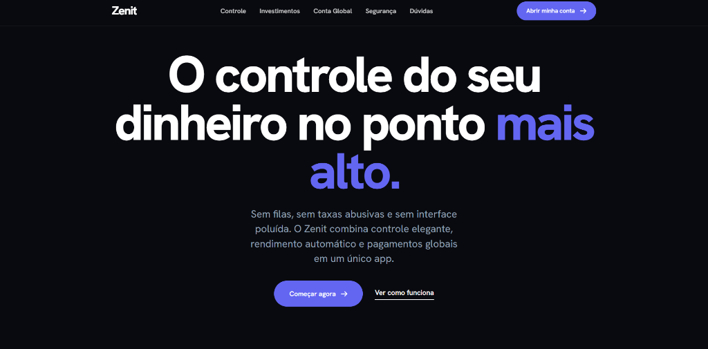

# Zenit — Banco Digital Minimalista 💳⚡

Projeto desenvolvido para a disciplina de **Front-End Design** da FIAP (Engenharia de Software - 2º Semestre), explorando a metodologia de **Vibe Coding**.

O objetivo da atividade é demonstrar repertório visual, comunicação precisa com ferramentas de IA, tomada de decisão em Identidade Visual (IDV) e capacidade de revisão crítica do design e código gerados.

---

## 🎯 Proposta do Produto
O **Zenit** é uma fintech de nova geração focada em alta performance financeira: rendimento automático a 100-115% do CDI, transferências globais com spread transparente de 0,9% e controle de gastos em tempo real, apresentada em uma estética brutalista contemporânea inspirada no *Nubank*, *C6 Bank* e *Bridge Money*.

---

## 🚀 Principais Seções e Recursos
1. **Navbar Fixa Minimalista:** Marca textual limpa "Zenit", links de seção e botão pill com microinteração de preenchimento e seta deslizante.
2. **Hero com Smartphone em Código:** Título gigante em escala fluida (*clamp*), sol ambiente e mockup de smartphone em puro CSS com Dynamic Island, dados de saldo e chips de notificações flutuantes.
3. **Métricas Dinâmicas:** Contadores numéricos animados ao entrar na viewport (`R$ 2,4 bi`, `+380 mil`).
4. **Controle Financeiro Pinned:** Palco fixado no scroll com troca sincronizada de 3 telas do app (categorias, anel de meta de gastos e extrato unificado).
5. **Investimentos:** Fundo verde sólido com número gigante de `13,8%` e gráfico SVG comparativo que se desenha com o scroll (*scrub*).
6. **Conta Multimoeda Global:** Carrossel horizontal deslizante no scroll com blocos de cores sólidas para USD, EUR, GBP e 45+ países.
7. **Segurança:** Fundo índigo sólido com lista tipográfica sequencial que acende progressivamente.
8. **Cartão Zenit Black 3D:** Cartão físico em titânio preto com rotação no scroll e inclinação sensível ao movimento do mouse.
9. **Depoimentos em Marquee:** Faixa contínua em loop infinito com cartões assimétricos.
10. **FAQ Hairline:** Accordion minimalista com linhas finas e abertura suave.
11. **CTA Final & Rodapé:** Chamada em escala monumental e rodapé com marca d'água gigante.

---

## 🛠️ Tecnologias Utilizadas
- **HTML5:** Semântica e acessibilidade nativa.
- **CSS3 Puro:** Sem dependência de Tailwind ou frameworks; variáveis CSS, layout com Grid/Flexbox e tipografia fluida.
- **Google Fonts (Hanken Grotesk):** Grotesca sólida nos pesos 400 a 800.
- **GSAP 3.13.0 + ScrollTrigger:** Animações orquestradas, pinning de seções e interpolação de SVG.
- **Lenis 1.3.4:** Rolagem suave com inércia natural.
- **Microinterações:** Efeito magnético em botões e tilt 3D em perspectiva.

---

## 📄 Diário de Bordo do Vibe Coding
O histórico completo de prompts, critérios de refinamento, eliminação dos clichês de IA e decisões técnicas está documentado em:
👉 [`processo-vibecode.md`](processo-vibecode.md)

---

## 💻 Como Executar
Abra o arquivo `index.html` em qualquer navegador ou inicie via extensão **Live Server** do VS Code. Não é necessário instalar nenhuma dependência ou Node.js.
