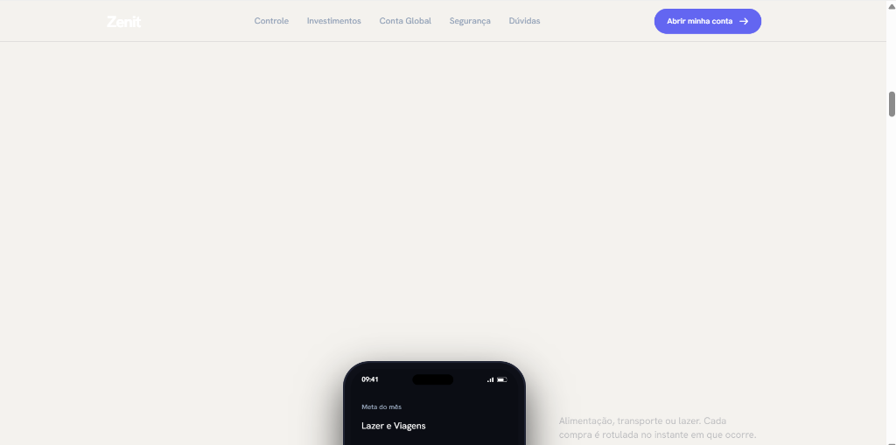

# Diário de Bordo — Vibe Coding: Projeto Zenit 🚀

Documento oficial de registro do processo de desenvolvimento, pesquisa, decisões de design e refinamento crítico da landing page do **Zenit**, em conformidade com as diretrizes da atividade de **Front-End Design** (FIAP — Engenharia de Software).

---

## 1. 🎯 Conceito, Naming & Proposta de Valor

### 🔹 Naming e Significado
- **Nome da Marca:** **Zenit** (zênite)
- **Significado Semiótico:** O ponto mais alto na esfera celeste, o pico absoluto sobre a cabeça de um observador.
- **Relação com o Produto:** Metáfora direta para a evolução patrimonial — levar a vida financeira, rendimentos e investimentos do usuário ao topo, sem atrito ou burocracia.

### 🔹 Posicionamento e Público-Alvo
- **Produto:** Banco digital e aplicativo financeiro de nova geração.
- **Público:** Jovens profissionais, desenvolvedores remotos, investidores e viajantes que exigem autonomia, câmbio transparente e controle de gastos com interface minimalista e contemporânea.
- **Proposta de Valor:** Simplicidade extrema, rentabilidade automática superior à poupança (100% a 115% do CDI com garantia FGC) e remessas globais com spread comercial real de 0,9%.

---

## 2. 🔍 Pesquisa de Mercado & Benchmarking Visual

Para fugir dos templates genéricos produzidos por assistentes de inteligência artificial, foi conduzida uma pesquisa prévia com três referências centrais do ecossistema financeiro:

| Referência | Elementos Analisados | O que foi absorvido no Zenit |
| :--- | :--- | :--- |
| **Nubank** (`nubank.com.br`) | Tipografia grotesca pesada, blocos de cores sólidas e contrastantes, ausência de ruído visual. | Tipografia *Hanken Grotesk* com títulos em escalas monumentais (*clamp*), alternância de fundos sólidos de tela cheia (dark, off-white, verde e índigo). |
| **C6 Bank** (`c6bank.com.br`) | Sofisticação dark mode, centralidade do cartão Black em metal, tom institucional seguro. | Cartão *Zenit Black* modelado em CSS 3D com rotação interativa ao scroll e inclinação no mousemove. |
| **Bridge Money** (`bridgemoney.co`) | Interações táteis focadas no smartphone, microinterações fluidas e dados dinâmicos. | Smartphone construído 100% em código (com Dynamic Island e status bar do iOS) e chips de notificações flutuantes com parallax. |

### 🚫 Mapeamento e Eliminação dos "Clichês de IA"
A inteligência artificial generativa tende a convergir para padrões repetitivos quando solicitada a criar interfaces web:
1. **Gradientes Roxos e Cianos Saturados:** Substituídos por blocos de cores 100% sólidas e paleta com identidade própria.
2. **Glassmorphism Excessivo com Glow:** Substituído por superfícies nítidas, contrastes bem definidos e linhas divisórias ultrafinas (*hairline*).
3. **Grids Monótonos de 3 Cards Idênticos:** Substituídos por estruturas variadas em cada seção (carrossel horizontal de moedas, lista tipográfica sequencial e palco com celular fixo).
4. **Ícones Genéricos em Caixinhas:** Substituídos por números editoriais grandes (`01`, `02`), dados reais da interface do app e gráficos vetoriais SVG desenhados sob demanda.

---

## 3. 🎨 Identidade Visual (IDV) & Sistema de Design

### 🔹 Paleta de Cores Sólidas
| Token | Cor Hexadecimal | Aplicação Principal | Papel Semiótico |
| :--- | :--- | :--- | :--- |
| **Dark Profundo** | `#090A0F` | Fundo do Hero, Conta Global, Depoimentos e Rodapé | Sobriedade, prestígio e foco na interface do app |
| **Papel / Off-White** | `#F4F2EE` | Fundo das seções Controle, Cartão Black e FAQ | Clareza editorial, conforto de leitura e quebra do dark |
| **Verde Rendimento** | `#10B981` | Seção completa de Investimentos e valores positivos | Crescimento patrimonial, rentabilidade e confiança |
| **Índigo Primário** | `#6366F1` | Seção completa de Segurança e Botões de CTA | Tecnologia, estabilidade e ação decisiva |
| **Bordas Dark** | `rgba(255, 255, 255, 0.12)` | Delimitação de cards e divisórias em fundos escuros | Estruturação sem poluição visual |
| **Bordas Light** | `rgba(9, 10, 15, 0.12)` | Linhas de FAQ e divisórias no tema papel | Precisão técnica e acabamento refinado |

### 🔹 Tipografia Editorial Brutalista
- **Família Tipográfica:** *Hanken Grotesk* (Google Fonts)
- **Escala de Títulos:** `clamp(3.2rem, 8vw, 7.5rem)` com peso 800, line-height ultracompacto (`0.95` a `1.0`) e tracking negativo (`-0.045em`).
- **Escala de Parágrafos:** `clamp(1.125rem, 1.8vw, 1.5rem)` com peso 400 e alto contraste.
- **Destaques:** Apenas cores sólidas contrastantes (`#6366F1` ou `#10B981`) ou sublinhados grossos — jamais texto com degradê.

### 🔹 Decisão de Design: Logotipo Tipográfico Definitivo
- **Consolidação da Marca:** Havia inicialmente a hipótese de importar um símbolo vetorial externo (`/public/logo.svg`). Porém, durante a avaliação visual dos Ciclos 2 e 3, a marca estritamente textual em **Hanken Grotesk 800** com tracking negativo (`-0.05em`) provou-se extremamente marcante, imponente e alinhada ao design editorial contemporâneo de fintechs globais (*Linear*, *Nubank*).
- **Conclusão:** Optou-se por consolidar o logo tipográfico diretamente em código HTML/CSS como a identidade definitiva do Zenit, eliminando qualquer símbolo figurativo ou dependência de asset externo.

---

## 4. 💬 Histórico Completo de Prompts & Análise Crítica

O desenvolvimento ocorreu através de **3 ciclos iterativos**, demonstrando a capacidade de direção de arte, especificação precisa e correção de rumo quando a IA entregou algo aquém do padrão exigido.

---

### 📝 Ciclo 1: Concepção da Landing Page e Estrutura Inicial

#### 💬 Prompt Enviado à IA:
```text
nome: Zenit: topo, pico, bom pra investimentos

Crie uma landing page completa para o Zenit, um app financeiro / banco digital minimalista de nova geração. Público: pessoas que querem controle financeiro elegante, investimentos inteligentes e transferências globais sem burocracia. Proposta: simplicidade extrema, segurança e visual premium em dark mode.

Referências de comportamento (inspirar na estrutura e nas interações, não copiar): bridgemoney.co, c6bank.com.br, nubank.com.br.

STACK
- React + Tailwind CSS + Framer Motion
- Responsivo (mobile first) e acessível

IDENTIDADE VISUAL
- Dark mode refinado, estilo Linear / Revolut / Arc
- Fundo: #090A0F
- Cards: #12141D e #1A1D2B, borda sutil #2A2F45
- Acento primário: #6366F1
- Sucesso/rendimento: #10B981
- Texto principal: #FFFFFF | secundário: #94A3B8
- Fonte: Plus Jakarta Sans (títulos em peso 700-800, tracking levemente negativo)
- Glassmorphism e glow só em elementos-chave (celular, card principal, CTA). Evitar o clichê de gradiente roxo em tudo e cards de vidro em todas as seções.

ESTRUTURA
1. Navbar fixa com blur, logo, links e botão de CTA
2. Hero: título grande com 1 ou 2 palavras em destaque (gradiente índigo para menta ou sublinhado desenhado), subtítulo curto, CTA principal e secundário. À direita ou abaixo, um celular em CSS/HTML com a interface do app funcionando dentro (não usar imagem estática)
3. Faixa de números/prova social (usuários, países, volume movimentado)
4. Seção "Controle": mostra saldo, gastos por categoria e gráfico dentro do celular, que muda a tela conforme o scroll
5. Seção "Investimentos": card de rendimento com valores em verde e mini gráfico animado
6. Seção "Transferências globais": cards de moedas, taxa e prazo
7. Seção "Segurança": 3 ou 4 itens com ícones e borda com glow
8. Cartão virtual com degradê, com leve efeito 3D ao passar o mouse
9. Depoimentos
10. FAQ em accordion
11. CTA final grande + footer

ANIMAÇÕES
- Cada seção entra com fade + slide up suave, elementos internos em stagger
- Palavras de destaque dos títulos com animação própria (gradiente deslizando ou sublinhado desenhando)
- O celular acompanha o scroll: troca de tela e faz parallax leve
- Números com contagem animada quando entram na viewport
- Hover com microinterações em botões e cards
- Respeitar prefers-reduced-motion

CTA
- Botão pill, fundo #6366F1 com glow, leve elevação no hover e seta animada
- Texto de ação direto ("Abrir minha conta", "Começar agora")
- Repetir o CTA no hero, no meio da página e no final

COPY
- Português do Brasil, frases curtas e diretas, sem jargão financeiro e sem clichês de IA
- Não usar travessão como separador

ENTREGA
- Código organizado em componentes por seção
- Dados mockados em um arquivo separado para fácil edição

faça da forma que aprendi nas aulas, sem ter que instalar nada, somente HTML e CSS.
```

#### ⚙️ O que a IA Entregou:
- Uma página HTML estruturada com classes utilitárias do Tailwind CDN, fonte *Plus Jakarta Sans*, ícones Boxicons e Javascript vanilla para o accordion do FAQ.
- Um mockup de smartphone em CSS básico no Hero e um cartão virtual com efeito de perspectiva.

#### 🔍 Análise Crítica do Aluno (Revisão e Diagnóstico):
- **O que funcionou:** A página carregava sem dependências externas (`npm`) e a copy estava bem estruturada em português.
- **O que decepcionou:** O visual final ainda tinha **"muita cara de template gerado por IA"**. A paleta era monótona (tudo no mesmo tom escuro com glow roxo), os títulos eram tímidos, havia caixinhas repetitivas de ícones translúcidos e faltava autenticidade brutalista compatível com o Nubank e C6.

---

### 📝 Ciclo 2: Redesign Radical — Identidade Própria e Movimento Brutalista

Diante do resultado genérico do Ciclo 1, foi emitido um comando detalhado de reformulação completa da direção de arte e das tecnologias de animação.

#### 💬 Prompt Enviado à IA:
```text
Refaça o design e as animações da landing page do Zenit. Mantenha a copy e as informações, mas mude estrutura, tipografia, componentes e movimento. O resultado atual parece gerado por IA. Quero algo com identidade própria, na linha de nubank.com.br, c6bank.com.br e bridgemoney.co.

REMOVER
- Gradientes em textos, fundos e botões (cores sólidas apenas)
- Glassmorphism e glow
- Pill/badge acima do título do hero
- Eyebrows pequenos em caixa alta colorida acima de cada título
- Ícones dentro de quadradinhos com fundo translúcido
- Grids de 3 ou 4 cards idênticos (ícone + título + texto)
- Layout "texto à esquerda, imagem à direita" repetido em todas as seções
- Logo gerado em código

TIPOGRAFIA
- Trocar Plus Jakarta Sans por uma grotesca sólida no estilo Nubank: Hanken Grotesk (ou Schibsted Grotesk)
- Títulos enormes (clamp 3rem a 7rem), peso 700, tracking negativo, line-height 0.95 a 1.05
- Texto corrido em peso 400, tamanho generoso, sem cinza muito apagado
- Destaque de palavras só com cor sólida (#6366F1 ou #10B981) ou com um bloco de cor atrás da palavra, nunca gradiente

LAYOUT
- Hero centralizado: título gigante ocupando quase a largura toda, CTA abaixo, e o celular entrando por baixo, cortado pela borda da seção. Pequenos chips de notificação (Pix recebido, rendimento do dia) flutuando ao redor do celular
- Alternar seções com fundos sólidos diferentes de tela cheia (preto #090A0F, índigo #6366F1 sólido, off-white com texto escuro, verde #10B981 sólido). Nada de tudo no mesmo fundo escuro
- Variar a estrutura de cada seção:
  - Controle: celular fixo (sticky) no centro, textos mudando dos lados enquanto a tela do app troca
  - Investimentos: número gigante de rendimento ocupando a seção, com gráfico de linha desenhando no scroll
  - Conta global: moedas em carrossel horizontal que anda com o scroll, cada uma em um bloco de cor diferente
  - Segurança: lista tipográfica grande (frases enormes que acendem uma a uma no scroll), sem ícones
  - Cartão: cartão ocupando a tela, rotacionando levemente com o scroll
  - Depoimentos: faixa horizontal em loop com cards de tamanhos diferentes
  - FAQ: lista simples com linhas finas, sem caixas
- Onde precisar de ícone, usar traço fino próprio, número grande, ilustração simples ou pedaços reais da interface do app. Nunca ícones genéricos de biblioteca em caixinhas

LOGO
- Usar o arquivo /public/logo.svg (vou fornecer). Enquanto não tiver, deixar apenas o texto "Zenit" em Hanken Grotesk 800, sem símbolo inventado

ANIMAÇÕES (prioridade máxima)
- Usar GSAP + ScrollTrigger e Lenis para scroll suave
- Títulos entram por linha, com máscara (texto sobe de dentro de uma linha invisível)
- Parágrafos aparecem palavra por palavra mudando a opacidade conforme o scroll
- A cor de fundo muda de forma contínua entre as seções ao rolar, sem corte seco
- Celular pinned em seções-chave, com troca de tela sincronizada ao scroll e parallax leve
- Números com contagem animada ao entrar na viewport
- Imagens e blocos com reveal por clip-path
- Botões com hover que preenche de baixo para cima e seta que desliza
- Cursor com leve efeito magnético nos CTAs (desktop)
- Respeitar prefers-reduced-motion

CTA
- Botão pill sólido #6366F1, texto branco, sem glow, hover com preenchimento deslizante
- Repetir no hero, no meio da página e no final, com texto direto

COPY
- Manter a atual, sem travessão como separador e sem frases de efeito genéricas
```

#### ⚙️ O que a IA Entregou:
- Reescrita completa em HTML semântico e CSS customizado puro (`vibecode/css/style.css`), sem depender de Tailwind.
- Tipografia brutalista com *Hanken Grotesk* e títulos `clamp`.
- Animações via **GSAP 3.13.0**, **ScrollTrigger** e **Lenis 1.3.4** (via CDN, sem instalação de Node).
- Gráfico SVG interativo em Investimentos, carrossel horizontal em Conta Global, lista tipográfica em Segurança e botões com preenchimento de baixo para cima.

---

### 📝 Ciclo 3: Inspeção no Navegador & Correção de Bugs de Viewport

Durante os testes locais no navegador (via Live Server), o aluno detectou uma falha visual grave ao rolar a página na seção de Controle.

#### 📸 Evidência do Erro Encontrado:


#### 💬 Prompt Enviado à IA para Correção:
```text
nessa seção Cada centavo classificado e no seu devido lugar.
Diga adeus a planilhas confusas. O Zenit agrupa seus gastos em tempo real com categorias automáticas e alertas de limite.

quando scrollo pra baixo, o site da uns bugs e fica cortado o celular. Corrija
```

#### 🔍 Diagnóstico Técnico do Problema:
1. **Quebra do Pinning Artificial via JS:** O ScrollTrigger estava fixando (`pin`) a div `.controle__pin` relativo ao topo da seção `#controle`. Como o cabeçalho (`.controle__head`) possuía um título grande de mais de 250px, o celular era fixado quando já estava posicionado na metade inferior da tela, gerando um enorme vazio no topo.
2. **Estouro da Viewport:** O smartphone tinha altura fixa de `640px`. Em telas com escala de 125% ou 150% do Windows, a altura útil da janela ficava em torno de 700px a 800px. Somando a navbar de 72px com o cabeçalho e o celular de 640px, a base do mockup ficava enterrada para fora da janela do navegador.
3. **Contraste da Barra de Navegação:** Ao rolar do Hero escuro para o fundo papel (`#F4F2EE`), a navbar adotava fundo claro, mas o logotipo textual "Zenit" e os links permaneciam brancos, tornando-se ilegíveis.

#### 🛠️ Solução Implementada:
1. **Substituição de JS Pin por CSS Sticky Nativo:** Em vez de depender de wrappers dinâmicos do GSAP (`pin-spacer`), a seção `#controle` recebeu altura total de `240vh`, contendo uma sub-estrutura `.controle__sticky` com `position: sticky; top: 0; height: 100vh; display: flex; flex-direction: column; justify-content: center;`.
2. **Dimensionamento Proporcional Fluido:** O celular passou a utilizar altura baseada na altura da janela: `height: clamp(430px, 54vh, 520px); aspect-ratio: 9 / 18.5;`. Com isso, ele nunca ultrapassa 54% da altura da tela, garantindo que o título superior, o celular central e os passos laterais caibam simultaneamente com folga em qualquer monitor.
3. **Sincronização de Telas:** O ScrollTrigger agora apenas escuta o progresso da rolagem (`self.progress`) para alternar as classes `.is-active` entre as telas 01, 02 (com anel de progresso SVG) e 03 (extrato unificado), permitindo também alternância instantânea por clique nos passos ou nas abas do app.
4. **Navbar Reativa a Temas:** Criação das classes `.is-light`, `.is-green` e `.is-indigo` para a navbar, fazendo o texto herdar `currentColor` e assumir preto sólido imediatamente ao entrar em seções claras.

---

## 5. ♿ Acessibilidade e Engenharia de Código

- **Zero Instalação:** Todas as dependências (Google Fonts, Lenis e GSAP) carregam via CDN pública de alta velocidade, permitindo clonar o repositório e abrir diretamente no navegador ou via extensão Live Server do VS Code.
- **Respeito ao `prefers-reduced-motion`:** Usuários com sensibilidade vestibular têm todas as animações pesadas, parallax e rolagem inercial desativados via media query, mantendo a página estática, funcional e perfeitamente legível.
- **Acessibilidade Semântica:** Uso de skip-link para navegação por teclado (`.skip`), elementos de título com hierarquia correta (`h1` a `h3`), tags ARIA adequadas (`role="img"`, `aria-label`, `aria-expanded` e `aria-controls` no FAQ).

---

## 6. 🏆 Conclusão & Aprendizados de Vibe Coding

Este projeto consolidou a aplicação prática da metodologia de **Vibe Coding**:
- A inteligência artificial atua com máxima eficácia quando alimentada com **diretrizes estéticas restritivas** (o que *não* fazer é tão importante quanto o que fazer).
- O desenvolvedor precisa exercer um **olhar crítico apurado**: o primeiro código gerado raramente atinge excelência de design sem intervenções arquiteturais.
- A combinação de pesquisa de mercado sólida (*Nubank*, *C6*, *Bridge Money*) com especificação técnica detalhada transforma uma página genérica em um produto digital com identidade, movimento orgânico e qualidade profissional.
